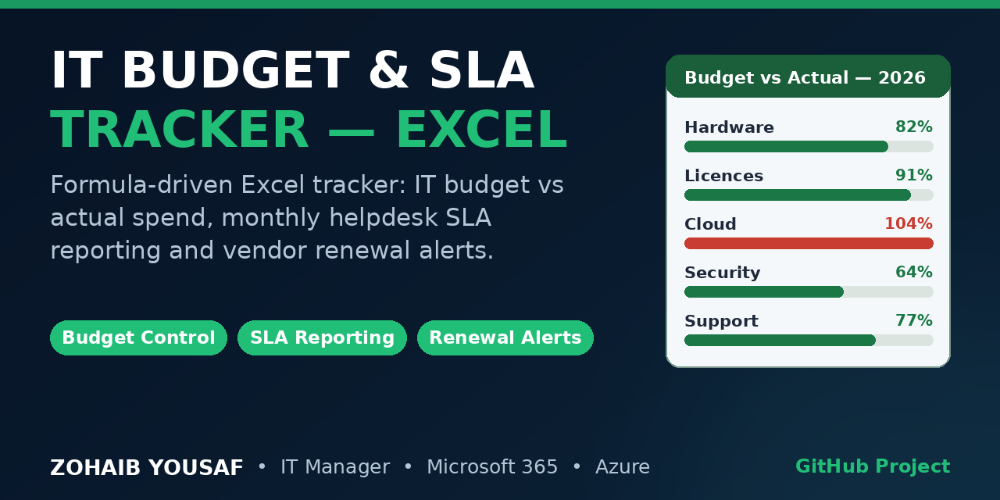

# IT Budget & SLA Tracker (Excel)



A formula-driven Excel workbook for two recurring IT management jobs: controlling the annual IT budget and reporting helpdesk SLA performance month by month. Built by Zohaib Yousaf, IT Manager.

No macros and no add-ins are used. Every headline figure is a standard Excel formula, so the workbook works in Microsoft Excel and Microsoft 365 and recalculates as soon as a register is updated.

## Sheets

| Sheet | Contents |
|---|---|
| Dashboard | One-page view of the numbers that matter: total annual IT budget, actual spend year to date, budget variance %, SLA met % year to date, tickets logged this month, and how many vendor contracts are flagged for renewal. Two charts: annual budget vs actual spend by item, and SLA % by month. Every KPI cell is a formula linked to the register sheets. |
| IT_Budget | The budget register. One row per budget line, grouped by category (Hardware, Software & Licences, Cloud (Azure/M365), Network, Security, Support Contracts, Training), with the annual budget, actual spend per quarter (Q1-Q4), and formula columns for total actual, remaining budget, variance % and a status of On Track or Over Budget. A totals row sums every column. Variance cells above zero and Over Budget lines are highlighted. |
| SLA_Monthly | One row per month (January to October 2026 in the sample data): tickets logged, resolved, resolved within SLA, the SLA percentage, average resolution time in hours, and P1 incident count. The totals row sums the volumes and works the overall SLA % out from the totals. Months below the 95% SLA target are highlighted. |
| Vendors | Contract register: vendor, service, contract start, renewal date, annual cost and notice period in days. Formula columns calculate days remaining to renewal and flag RENEW SOON once a contract is inside its notice period. |
| Summary | A small formula-only table (month, tickets logged, SLA %) that reads SLA_Monthly and feeds the Dashboard charts. Nothing on this sheet is typed in by hand. |

## Key formulas

- Total actual spend per budget line: `=SUM(Q1:Q4)`
- Remaining budget: `=Annual Budget - Total Actual`
- Variance %: `=(Total Actual - Annual Budget) / Annual Budget` (positive means over budget)
- Line status: `=IF(Total Actual > Annual Budget, "Over Budget", "On Track")`
- Monthly SLA %: `=Resolved Within SLA / Tickets Logged`
- Days to renewal: `=Renewal Date - TODAY()`
- Renewal alert: `=IF(Days to Renewal <= Notice Period, "RENEW SOON", "OK")`
- Dashboard KPIs link directly to the totals rows, for example `=IT_Budget!H12` for spend year to date and `=SLA_Monthly!E12` for the year-to-date SLA percentage.

## How to run

Use the workbook: open `IT_Budget_SLA_Tracker.xlsx` in Excel or Microsoft 365, update the quarterly actuals, the monthly SLA figures and the vendor dates, and the Dashboard follows automatically.

Rebuild the workbook from code (the generator script creates the same file, including all formatting, tables and charts):

```bash
pip install openpyxl
python build_workbook.py
```

## Sample data

The workbook ships with realistic sample data (10 budget lines, 10 months of SLA figures, 7 vendor contracts) so every formula and chart works on first open. It is sample data only; replace it with your own figures before using the workbook for real reporting.

## Author

Zohaib Yousaf — IT Manager, Islamabad, Pakistan

- Website: https://zohaibyousaf.com
- LinkedIn: https://linkedin.com/in/zohaibyousaf
- Email: info@zohaibyousaf.com

## License

MIT — see LICENSE.
